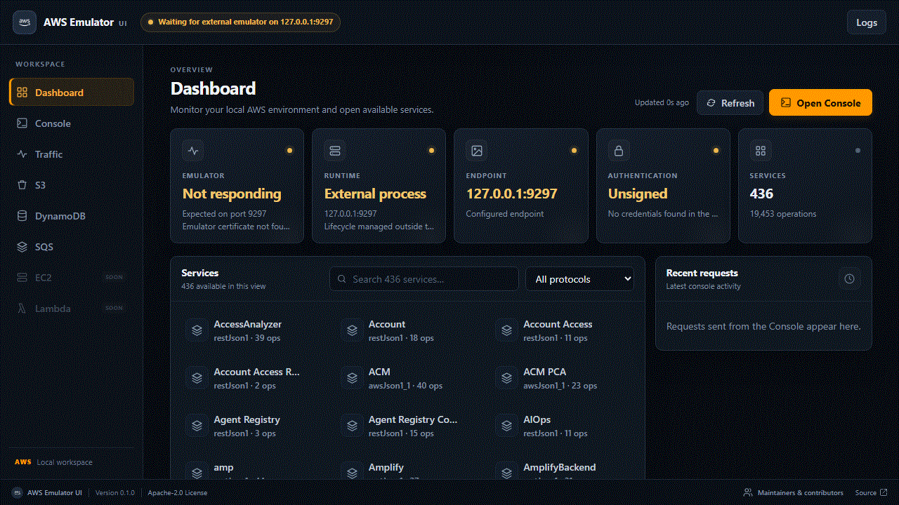

# AWS Emulator UI

**Current release: 0.4.0** · [Release notes](RELEASENOTE.md)

A local companion web application for [AWS Emulator](https://github.com/aws/aws-emulator). The UI provides Docker, native, and external-process connections; a live SDK traffic inspector; a Smithy-model-driven service console; and visual S3, DynamoDB, and SQS views.



The browser talks only to the local Node.js backend. The backend optionally reads service models from an AWS Emulator checkout, signs UI-generated requests with the emulator-generated credentials, and sends them to the emulator over certificate-verified HTTPS. The separate loopback traffic proxy forwards and records calls from local applications.

> AWS Emulator is intended for local development and testing. It does not require an AWS account and must not be used for production workloads.

## Repositories

- **AWS Emulator UI:** [github.com/Thanvirassif731/ui-for-aws-emulator](https://github.com/Thanvirassif731/ui-for-aws-emulator)
- **Official AWS Emulator:** [github.com/aws/aws-emulator](https://github.com/aws/aws-emulator)
- **AWS Emulator documentation:** [AWS Emulator User Guide](https://docs.aws.amazon.com/emulator/latest/userguide/what-is-service.html)
- **Docker setup guide:** [Getting started with Docker](https://docs.aws.amazon.com/emulator/latest/userguide/getting-started-docker.html)

## Prerequisites

Install the following before starting:

- **Git** (needed only when cloning source repositories)
- **Node.js 18.x, 20.x, or 22 and later** with npm. Node.js 20 LTS or a newer LTS release is recommended.
- One AWS Emulator runtime:
  - an already-running emulator on any operating system,
  - the official native Linux package, or
  - **Docker Desktop** or another Docker daemon and CLI.
- A modern web browser

Docker is optional in `native` and `external` modes. The [official AWS distribution](https://docs.aws.amazon.com/emulator/latest/userguide/getting-started.html) currently provides native packages for Linux; Windows and macOS use Docker unless you supply a compatible executable yourself through `EMULATOR_BINARY`.

> AWS platform availability details above are based on the linked official documentation. Content was rephrased for compliance with licensing restrictions.

Verify Node.js in PowerShell. Run the Docker commands only when using Docker mode:

```powershell
node --version
npm --version
docker --version
docker info
```

The Docker workflow installs the prebuilt AWS Emulator package. Rust and Cargo are required only when building the official emulator from source.

## Recommended repository layout

Clone both repositories as siblings:

```text
aws-emulator-open-source/
├── aws-emulator/
│   ├── Dockerfile
│   └── services/
└── ui-for-aws-emulator/
    ├── server/
    ├── web/
    └── package.json
```

PowerShell setup:

```powershell
New-Item -ItemType Directory -Path aws-emulator-open-source
Set-Location aws-emulator-open-source

git clone https://github.com/aws/aws-emulator.git
git clone https://github.com/Thanvirassif731/ui-for-aws-emulator.git

Set-Location ui-for-aws-emulator
$env:EMULATOR_REPO = (Resolve-Path "..\aws-emulator").Path
npm ci
```

The sibling checkout is detected automatically. Set `EMULATOR_REPO` only when the official repository is elsewhere. A checkout is needed for the universal Smithy Console and Docker image builds, but not for the dedicated S3, DynamoDB, SQS, or Traffic pages.

## Quick start: connect to an existing emulator

Use external mode when AWS Emulator is already running, whether it was started from Docker, a native package, or another tool:

```powershell
Set-Location "path\to\ui-for-aws-emulator"
$env:EMULATOR_MODE = "external"
$env:EMULATOR_HOST = "127.0.0.1"
$env:EMULATOR_PORT = "9297"
npm ci
npm run dev
```

The UI observes the configured endpoint and does not start, stop, or require Docker.

## Quick start: let the UI manage a native process

The official native package is available on Linux. After `aws-emulator` is on `PATH`:

```bash
cd ui-for-aws-emulator
EMULATOR_MODE=native npm run dev
```

To use another compatible executable on Linux, Windows, or macOS, set an absolute path:

```powershell
$env:EMULATOR_MODE = "native"
$env:EMULATOR_BINARY = "C:\path\to\aws-emulator.exe"
npm run dev
```

The UI starts the process with `-b <EMULATOR_HOST> -p <EMULATOR_PORT>` and can stop only the process it started.

## Quick start: let the UI manage Docker

From the UI repository root:

```powershell
$env:EMULATOR_REPO = (Resolve-Path "..\aws-emulator").Path
npm ci
npm run dev
```

Open [http://localhost:5173](http://localhost:5173).

In the application header:

1. Select **Build image**. The UI reads `$env:EMULATOR_REPO\Dockerfile` and streams it to Docker without sending the large emulator repository as build context.
2. Wait for the image build to finish.
3. Select **Start**.
4. Wait until the status changes to **Emulator running on :9297**.
5. Open **Console** or **S3**.

Development mode runs both processes:

- Vite web server: `http://127.0.0.1:5173`
- Express API: `http://127.0.0.1:8787`
- Traffic proxy: `http://127.0.0.1:8790`
- S3 Learning Sandbox website endpoint: `http://localhost:8791/s3-web/<bucket>/`
- AWS Emulator HTTPS endpoint: `https://127.0.0.1:9297`

Vite proxies browser requests under `/api` to the Express backend.

## Production-style local run

Build the React application and serve it from Express:

```powershell
$env:EMULATOR_REPO = (Resolve-Path "..\aws-emulator").Path
npm ci
npm run build
npm start
```

Open [http://localhost:8787](http://localhost:8787). Keep this terminal running while using the application.

## Upgrade from 0.1.0

No data migration is required. From the UI repository root:

```powershell
git pull
npm ci
npm run build
npm start
```

Review `EMULATOR_MODE` before starting. The default remains `docker`; use `native` or `external` when Docker should not manage the emulator.

## Exact Docker commands

The UI can perform these steps through **Build image** and **Start**. The commands below provide the equivalent manual workflow.

### Dockerfile used by the UI

The UI reads the official emulator checkout's `Dockerfile`. Its current content is:

```dockerfile
FROM public.ecr.aws/amazonlinux/amazonlinux:2023-minimal
ADD https://downloads.aws.com/aws-emulator/packages/aws-emulator/LTS/latest/aws-emulator-x86_64.rpm /tmp/aws-emulator.rpm
RUN rpm -i /tmp/aws-emulator.rpm && rm /tmp/aws-emulator.rpm \
    && mkdir -p /home/emulator && chown 1000 /home/emulator
USER 1000
ENV HOME=/home/emulator
EXPOSE 9297
ENTRYPOINT ["aws-emulator", "-b", "0.0.0.0"]
```

The UI replaces `aws-emulator-x86_64.rpm` with `aws-emulator-aarch64.rpm` automatically when its Node.js process runs on ARM64.

### Build exactly as the UI does

The backend executes `docker build --progress=plain -t aws-emulator -` and supplies the Dockerfile over standard input:

```powershell
$env:EMULATOR_REPO = (Resolve-Path "..\aws-emulator").Path
Get-Content -Raw "$env:EMULATOR_REPO\Dockerfile" |
  docker build --progress=plain -t aws-emulator -
```

The trailing `-` tells Docker to read the Dockerfile from standard input. No repository build context is uploaded to Docker.

A conventional build also works because this Dockerfile does not use `COPY`:

```powershell
docker build --progress=plain -t aws-emulator "$env:EMULATOR_REPO"
```

### Run exactly as the UI does

With the default names and ports, the UI constructs the following command:

```powershell
New-Item -ItemType Directory -Force -Path "$HOME\.aws\emulator" | Out-Null

docker run -d `
  --name aws-emulator-ui `
  --memory=2g `
  --memory-swap=2g `
  -p "127.0.0.1:9297:9297" `
  -v "${HOME}/.aws/emulator:/home/emulator/.aws/emulator" `
  aws-emulator `
  -p 9297
```

The Dockerfile entry point already supplies `aws-emulator -b 0.0.0.0`. The final `-p 9297` is appended to that entry point.

To disable AWS Emulator telemetry for this container, append `--telemetry off`:

```powershell
docker run -d `
  --name aws-emulator-ui `
  --memory=2g `
  --memory-swap=2g `
  -p "127.0.0.1:9297:9297" `
  -v "${HOME}/.aws/emulator:/home/emulator/.aws/emulator" `
  aws-emulator `
  -p 9297 --telemetry off
```

Useful lifecycle commands:

```powershell
docker logs --tail 200 aws-emulator-ui
docker stop aws-emulator-ui
docker start aws-emulator-ui
docker restart aws-emulator-ui
docker rm aws-emulator-ui
```

`docker rm` removes the stopped container. Confirm that you no longer need it before running that command.

## Connect a manually started emulator to the UI

Use this flow if you prefer to run Docker yourself.

### 1. Build and start AWS Emulator

Run the build and `docker run` commands from the previous section. Confirm that the container is running:

```powershell
docker ps --filter "name=aws-emulator-ui"
docker logs --tail 50 aws-emulator-ui
```

### 2. Verify emulator readiness

The emulator generates a local certificate under `$HOME\.aws\emulator\9297\ca.pem`. Use it to check the HTTPS readiness endpoint:

```powershell
curl.exe `
  --cacert "$HOME\.aws\emulator\9297\ca.pem" `
  https://127.0.0.1:9297/__admin/health
```

A ready emulator returns:

```text
ok
```

Do not use an insecure TLS flag. The UI backend verifies the emulator certificate using this generated CA file.

### 3. Start the UI

In a second PowerShell terminal:

```powershell
Set-Location "path\to\aws-emulator-open-source\ui-for-aws-emulator"
$env:EMULATOR_REPO = (Resolve-Path "..\aws-emulator").Path
$env:EMULATOR_HOST = "127.0.0.1"
$env:EMULATOR_PORT = "9297"
$env:EMULATOR_HOME = "$HOME\.aws\emulator"
$env:EMULATOR_REGION = "us-east-1"

npm ci
npm run dev
```

Open [http://localhost:5173](http://localhost:5173). The dashboard can report a healthy emulator even when Docker was started outside the UI.

## Inspect live SDK traffic

The backend starts a loopback HTTP proxy on `http://127.0.0.1:8790`. Point a local SDK or AWS CLI process at it while using the emulator's generated credentials:

```powershell
$env:AWS_ENDPOINT_URL = "http://127.0.0.1:8790"
```

Open **Traffic** to inspect request and response headers, payloads, status codes, and duration. The proxy forwards each call to the configured HTTPS emulator and verifies `ca.pem`. Captures stay in memory, keep the latest 200 calls, truncate each displayed body at 256 KiB, and redact authorization, security-token, and cookie headers. The proxy binds only to loopback and does not perform TLS interception.

## How the UI connects to AWS Emulator

1. The Express backend reads Smithy models from `<EMULATOR_REPO>/services/service-*/smithy-model/` to build the service and operation catalog.
2. AWS Emulator serves HTTPS on `127.0.0.1:9297` by default.
3. The container mount exposes generated runtime files under `<EMULATOR_HOME>/9297/`.
4. The backend reads `ca.pem` and uses it as the trusted CA for every emulator request.
5. The backend reads `emulator_credentials` and signs supported service requests with SigV4 through `aws4`.
6. The browser sends requests only to the local Express API. The browser never reads the generated credentials directly.

No AWS account or real AWS credentials are required.

### Generated runtime files

Do not create these files manually. AWS Emulator writes them while it is running:

```text
~/.aws/emulator/9297/
├── ca.pem
├── truststore.p12
├── emulator_credentials
└── config
```

The generated credentials file uses this structure, with generated values:

```ini
[default]
aws_access_key_id = <generated-access-key>
aws_secret_access_key = <generated-secret-key>
```

The generated AWS config has this structure:

```ini
[default]
region = us-east-1
endpoint_url = https://127.0.0.1:9297
ca_bundle = <path-to-ca.pem>
s3 =
  signature_version = s3v4
```

## Configuration

The UI does not load a `.env` file. Set variables in the shell before running `npm run dev`, `npm start`, or `npm test`.

| Variable | Default | Purpose |
|---|---:|---|
| `UI_API_PORT` | `8787` | Express API and production web port |
| `UI_WEB_PORT` | `5173` | Vite development server port |
| `UI_PROXY_PORT` | `8790` | Loopback HTTP port for intercepted SDK traffic |
| `UI_WEBSITE_PORT` | `8791` | Loopback HTTP port of the S3 Learning Sandbox website endpoint |
| `EMULATOR_MODE` | `docker` | Runtime control: `docker`, `native`, or `external` |
| `EMULATOR_BINARY` | `aws-emulator` | Executable name or absolute path used in native mode |
| `EMULATOR_PORT` | `9297` | Emulator HTTPS port and generated runtime directory name |
| `EMULATOR_HOST` | `127.0.0.1` | Emulator host used by the Express backend |
| `EMULATOR_REGION` | `us-east-1` | SigV4 signing region |
| `EMULATOR_HOME` | `$HOME/.aws/emulator` | Host directory containing generated CA and credentials |
| `EMULATOR_REPO` | Sibling `../aws-emulator` checkout | Optional source of the Dockerfile and Smithy models |
| `EMULATOR_SEED_FILE` | Unset | Snapshot JSON file to restore once when the emulator first becomes healthy |

`EMULATOR_SEED_FILE` accepts an absolute path or a path relative to the directory where the UI server starts. The server validates and applies the version 1.0 snapshot once, without wiping existing resources. Use the header's **Restore seed** control when you need the clean-wipe option.

When the emulator checkout is not a sibling, set its location explicitly:

```powershell
$env:EMULATOR_REPO = (Resolve-Path "..\aws-emulator").Path
```

To use non-default UI ports:

```powershell
$env:UI_API_PORT = "8877"
$env:UI_WEB_PORT = "5273"
$env:UI_PROXY_PORT = "8890"
$env:UI_WEBSITE_PORT = "8891"
npm run dev
```

### Persisted Docker names

The UI writes selected Docker image and container names to the git-ignored `server/settings.json` file. Its default content is:

```json
{
  "imageName": "aws-emulator",
  "containerName": "aws-emulator-ui"
}
```

Valid image names may contain letters, numbers, `_`, `.`, `/`, `:`, `@`, and `-`. Valid container names may contain letters, numbers, `_`, `.`, and `-`.

### Optional emulator telemetry configuration

AWS Emulator telemetry is enabled by default. To disable it for every run, create `$HOME\.aws\emulator\config.toml` with:

```toml
[telemetry]
enabled = false
```

See [Telemetry in AWS Emulator](https://docs.aws.amazon.com/emulator/latest/userguide/telemetry.html) for details.

## Available pages

- **Dashboard:** emulator runtime, authentication, indexed service totals, and recent-request status.
- **Header snapshots:** export portable S3, DynamoDB, and SQS state, or restore a seed with an optional clean wipe.
- **Console:** Smithy-model-driven operation requests and raw HTTP requests with optional SigV4 signing.
- **Traffic:** live inspection of SDK calls sent through the loopback proxy.
- **S3:** bucket and object browsing, upload, download, preview, folders, filters, and deletion, plus the S3 Learning Sandbox tabs described below.
- **DynamoDB:** table picker and paginated item grid with typed AttributeValue rendering.
- **SQS:** queue attributes, message inspection, send, delete, and purge controls.
- **EC2:** instance launch, filtering, details, lifecycle controls, Docker-backed Ubuntu sandboxes, user data, port forwarding, and browser terminals.
- **Credits:** version, license, source repository, maintainers, and contributors.

### EC2 Local Compute Bridge

The EC2 page checks the local Docker daemon independently of the emulator runtime. Supported AMI presets create containers named `aws-emu-ec2-<instance-id>` after the emulator allocates the EC2 metadata. Stop, start, reboot, and terminate actions are then mirrored to that managed container. If Docker is stopped or an AMI has no local mapping, EC2 remains usable in metadata-only mode.

The Ubuntu preset runs `ubuntu:24.04`. User data is written to `/var/lib/cloud/instance/user-data.sh`; its output is available at `/var/log/cloud-init-output.log` and through **View Cloud-Init Boot Logs** in the browser terminal. Port mappings use `host:container` syntax, such as `8080:80`, and bind only to `127.0.0.1`.

The Docker-in-Docker preset runs a privileged local container so its nested daemon can work. The launch form requires explicit approval. Privileged containers have broad host kernel and device access, so run only scripts you trust.

### S3 Learning Sandbox

The emulator stores website configurations, Block Public Access settings, bucket policies, object versions, and lifecycle rules. It does not serve websites over HTTP, check bucket policies for anonymous website visitors, or run lifecycle expiration. The sandbox (`server/s3LearningBridge.js`) adds those behaviors. It uses `@aws-sdk/client-s3`, and the emulator stays the only store of data. Each bucket page has four tabs:

- **Objects & Versions:** a versioning badge (`PutBucketVersioning`) and a **Show All Versions** switch (`ListObjectVersions`). The switch lists each key's versions, labeled Latest, Previous Version, or Delete Marker. **Restore Object** removes the latest delete marker. The server refuses to delete any version that holds data through this button.
- **Static Website:** enable or disable hosting (`PutBucketWebsite` / `DeleteBucketWebsite`), set the index and error documents, upload a sample portfolio site, and see a readiness checklist. The endpoint `http://localhost:8791/s3-web/<bucket>/` answers with S3-style XML errors: `404 NoSuchWebsiteConfiguration`, `403 AccessDenied`, and `404 NoSuchKey`. An `X-Learner-Hint` response header explains each error. A request is refused when `BlockPublicPolicy` or `RestrictPublicBuckets` is on, or when the bucket policy does not allow anonymous `s3:GetObject` on the requested key.
- **Permissions:** Block Public Access settings, a bucket policy JSON editor with three beginner presets, and a policy simulator. The simulator evaluates the editor's draft: an explicit Deny wins, then any Allow, and everything else is an implicit deny. It supports wildcards, `NotAction`/`NotResource`/`NotPrincipal`, and the `String*`, `Arn*`, `Bool`, `Numeric*`, and `Null` condition operators, with or without `IfExists`. The simulator does not evaluate other operators, such as `IpAddress` or `ForAnyValue:`. It treats statements that use them as not matching and shows a warning. It evaluates only the bucket policy, not IAM identity policies.
- **Lifecycle & Time-Travel:** create or delete lifecycle rules with a prefix filter, `Expiration.Days`, and `NoncurrentVersionExpiration.NoncurrentDays`. The **+1 Day**, **+7 Days**, and **+30 Days** buttons advance a per-bucket simulated clock. After each jump, the sandbox applies Enabled rules to every version, deleting objects in the emulator, and shows an audit log of what happened. Current versions age from their last-modified time. Noncurrent versions age from the time a newer version or delete marker replaced them, which is how S3 counts. The sandbox skips rules that filter on tags or perform transitions and reports each skip. The simulated clock is kept in server memory and resets when the server restarts.

Lambda remains a navigation placeholder. Its operations and the complete EC2 operation catalog remain available through **Console**.

## npm commands

| Command | Action |
|---|---|
| `npm ci` | Install the exact dependencies recorded in `package-lock.json` |
| `npm install` | Install dependencies and update the lock file when required |
| `npm run dev` | Run the Express backend and Vite frontend together |
| `npm run dev:server` | Run only Express with Node watch mode |
| `npm run dev:web` | Run only Vite |
| `npm run build` | Create the production web build under `web/dist/` |
| `npm start` | Run Express and serve `web/dist/` when present |
| `npm test` | Run request-construction and model-index tests once |

## Limits and current behavior

- Uploads through the S3 page and objects included in snapshots are limited to 16 MiB per object.
- Snapshot imports use the backend's JSON request-body limit; SQS exports can optionally include up to 10 currently available messages per queue.
- Inline S3 previews are limited to 256 KiB.
- Emulator responses captured by the backend are limited to 20 MiB.
- Traffic request and response previews are limited to 256 KiB per direction and the latest 200 calls.
- REST XML request bodies are generated from Smithy structures, lists, maps, flattened members, attributes, namespaces, blobs, and timestamps. **Body override** remains available for unusual payloads.
- Unsupported Smithy protocols can still be tested through **Raw HTTP**.
- Emulator service state is in memory. Do not treat the container mount as durable service-resource storage.

## Security

- Express, Vite, the traffic proxy, and the S3 website endpoint bind to loopback addresses only.
- The S3 website endpoint runs on its own port (origin), so HTML stored in a bucket cannot call the UI API. It accepts only loopback `Host` values and only `GET` and `HEAD` requests.
- Captured traffic stays in memory, truncates large bodies, and redacts credential-bearing headers.
- Docker publishes the emulator and EC2 sandbox port forwards only on `127.0.0.1`.
- EC2 terminal WebSockets enforce the same loopback `Host` and `Origin` checks as REST requests.
- Docker-in-Docker requires an explicit privileged-container approval in the launch form.
- Express rejects unknown `Host` and `Origin` values.
- State-changing API calls require JSON.
- The backend verifies emulator TLS with `ca.pem`.
- Generated local credentials are used only by the backend for emulator requests.

## Troubleshooting

### No services appear

Confirm that `EMULATOR_REPO` points to the official checkout and contains `services/` and `Dockerfile`:

```powershell
$env:EMULATOR_REPO
Test-Path "$env:EMULATOR_REPO\Dockerfile"
Test-Path "$env:EMULATOR_REPO\services"
```

Restart the UI after changing the variable.

### Docker is unavailable

```powershell
docker info
docker ps
```

Start Docker Desktop if these commands fail.

### Certificate not found

Confirm that the emulator is running and that the configured port directory contains `ca.pem`:

```powershell
Test-Path "$HOME\.aws\emulator\9297\ca.pem"
docker logs --tail 100 aws-emulator-ui
```

The emulator creates runtime files after its HTTPS listener starts.

### Port already in use

Find listeners on the default ports:

```powershell
Get-NetTCPConnection -LocalPort 5173,8787,8790,8791,9297 -ErrorAction SilentlyContinue
```

Stop the conflicting process or set matching `UI_WEB_PORT`, `UI_API_PORT`, `UI_PROXY_PORT`, `UI_WEBSITE_PORT`, and `EMULATOR_PORT` values before startup.

## Testing

Set `EMULATOR_REPO` so tests can read the real Smithy models, then run:

```powershell
$env:EMULATOR_REPO = (Resolve-Path "..\aws-emulator").Path
npm test
npm run build
```

The automated suite covers model indexing, request construction, REST XML serialization, traffic capture/redaction, snapshot validation, restore batch sizes, oversized S3 snapshot behavior, and Local Compute Bridge validation and container configuration. It does not start Docker, spawn the native emulator, or run browser end-to-end tests.

## License

AWS Emulator UI is licensed under the [Apache License 2.0](LICENSE).

The official AWS Emulator repository has its own licensing terms: most emulator code is licensed under CC0-1.0, while its `vendor/` directory is licensed under Apache-2.0. See the [AWS Emulator license](https://github.com/aws/aws-emulator/blob/main/LICENSE) for details.

## Release notes

See [RELEASENOTE.md](RELEASENOTE.md) for version history, features, limits, and upgrade notes.
